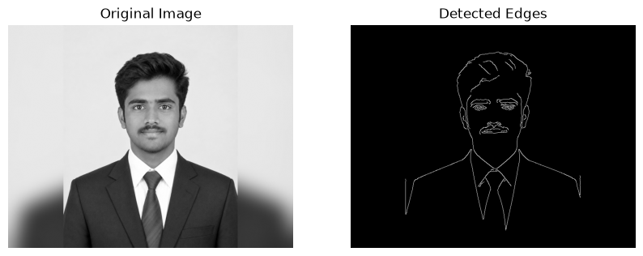

# Workshop 3 – Canny Edge Detection using OpenCV

## Name : MUTHUAKASH M

## Register Number : 212225230194

## Aim

To detect edges in an image using the Canny Edge Detection technique in OpenCV by applying Gaussian Blur to reduce noise.

## Software Requirements

- Python
- Jupyter Notebook
- OpenCV
- Matplotlib

## Algorithm

1. Import the required libraries OpenCV and Matplotlib.
2. Read the input image in grayscale using `cv2.imread()`.
3. Apply Gaussian Blur using a 5×5 kernel to reduce noise.
4. Apply Canny Edge Detection with threshold values 50 and 150.
5. Display the original grayscale image.
6. Display the detected edges.
7. Compare the original image with the edge-detected image.

## Program 1: Import Libraries

```python
import cv2
import matplotlib.pyplot as plt
```

## Program 2: Read the Input Image in Grayscale

```python
img = cv2.imread('Qno. 1.jpg', cv2.IMREAD_GRAYSCALE)
```

## Program 3: Apply Gaussian Blur

```python
blurred = cv2.GaussianBlur(img, (5, 5), 0)
```

## Program 4: Apply Canny Edge Detection

```python
edges = cv2.Canny(blurred, 50, 150)
```

## Program 5: Display Original Image and Detected Edges

```python
plt.figure(figsize=(10, 5))

plt.subplot(121), plt.imshow(img, cmap='gray')
plt.title('Original Image'), plt.axis('off')

plt.subplot(122), plt.imshow(edges, cmap='gray')
plt.title('Detected Edges'), plt.axis('off')

plt.show()
```

## Output



## Result

Thus, Canny Edge Detection was successfully implemented using OpenCV in Python. Gaussian Blur was applied to reduce noise, and the edges were detected and displayed successfully.